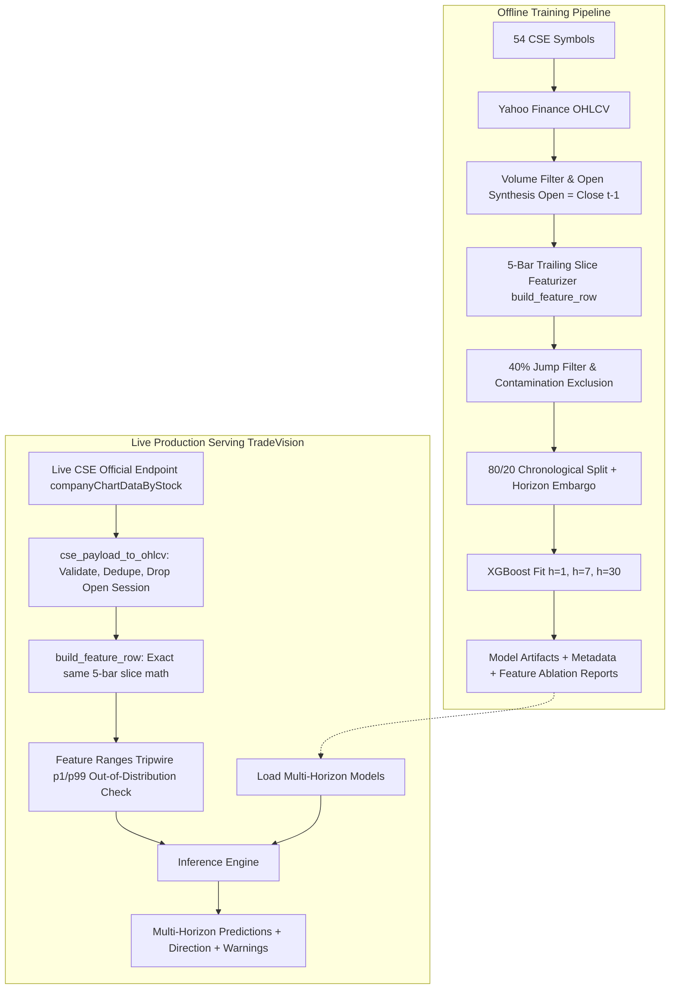

# CSE Stock Analyzer

A reproducible machine-learning research toolkit for analyzing Colombo Stock Exchange (CSE) securities and estimating their **future cumulative returns over 1, 7, and 30 trading sessions** using a unified **5-bar slice contract** that guarantees exact parity between historical training and live exchange serving.

> **Project status:** research/portfolio project. Not a live trading system and not financial advice.

## What problem does this solve?

**Sri Lankan equity analysis is manual and time-constrained.** The CSE lists roughly 300 companies across the ASPI and S&P SL20, and an investor or analyst following it faces three recurring friction points:

1. **Screening burden.** Reviewing hundreds of tickers by hand (checking charts, volume, momentum) before a market open takes hours, so coverage frequently collapses to a handful of familiar large caps.
2. **Inconsistent process.** Judgement-based reading of RSI, moving averages, and volume spikes varies day to day and person to person; nothing is standardized or auditable.
3. **Train/Serve distribution drift.** Models trained on clean, deep historical vendor feeds (e.g. Yahoo Finance) break in production when live local exchange feeds only provide short lookback windows (~23 daily bars) without an open price.

**What this project provides instead:**

- **A daily screening shortlist, in seconds.** One command scores any list of tickers consistently against the same model so you can compare and rank them by expected return. For example, comparing three securities it might show: HNB looks strongest (+0.25%), COMB next (+0.12%), JKH flat (−0.03%), directing attention to the strongest candidates.
- **The 5-Bar Slice Contract ("Train = Serve by construction").** Every feature is derived exclusively from a trailing 5-bar window (`s0..s4`). Recursive indicators (EMA, MACD) are seeded inside the slice rather than across full historical time series. This ensures mathematical bit-identity whether computed on 5 years of training data or a 23-bar live exchange payload.
- **Synthesized Open price.** The official CSE API payload contains no open price (`o: null`). To prevent distribution skew, `Open(t)` is formally defined as `Close(t-1)` on both training and serving sides; raw vendor Open prices are discarded at ingestion.
- **Time-horizon choice.** Separate 1-, 7-, and 30-session models match different investment decisions: a day trader reviews tomorrow's expected move, a swing trader the coming week, and a position trader the coming month.
- **Coverage of the whole board, not just big names.** The model is **cross-sectional**: it uses no company ID, only scale-independent pattern-of-price-and-volume inputs, so it scores any CSE stock with sufficient history, including smaller tickers it never trained on.
- **Honest evaluation & out-of-distribution tripwires.** Every model is benchmarked against a zero-return baseline with a chronological, embargoed split. In live serving, feature values are compared against training-set `[p1, p99]` bands to surface out-of-distribution warnings in real time without silent failure.

---

## Performance Summary (Retrained 5-Bar Models)

Evaluated on out-of-sample chronological test sets (20% holdout per asset, with a strict label embargo to eliminate look-ahead leakage):

| Horizon | Decision Context | Training Rows | Test Rows | Directional Accuracy | Model MAE | Zero-Return Baseline MAE | Beats Baseline? |
|---|---|---|---|---|---|---|---|
| **1-Day (`h=1`)** | Day trader / next session | 43,389 | 10,890 | 54.96% | 0.01328 | 0.01314 | No (Noise-dominated) |
| **7-Day (`h=7`)** | Swing trader / weekly | 42,784 | 10,811 | 57.56% | 0.03921 | 0.03925 | **Yes** (MAE edge + 57.6% dir) |
| **30-Day (`h=30`)** | Position trader / monthly | 40,442 | 10,537 | **65.73%** | 0.09073 | 0.09529 | **Yes** (Strong edge: −0.46% MAE) |

*Key finding:* Daily returns (`h=1`) are noise-dominated and lose to the zero-return baseline. However, weekly (`h=7`) and monthly (`h=30`) horizons exhibit genuine technical momentum persistence on the CSE, with the 30-day model achieving 65.7% directional accuracy and comfortably outperforming the baseline.

---

## Highlights

- **54-symbol, sector-diverse CSE universe** across banking, manufacturing, hospitality, conglomerates, and plantation sectors.
- **Multi-horizon regression:** 1, 7, and 30 trading sessions (one dedicated model per horizon).
- **The 5-bar slice architecture:** mathematically guarantees zero train/serve drift.
- **Live CSE API ingestion engine (`cse_payload_to_ohlcv`):** maps raw exchange JSON records (`p`, `h`, `l`, `q`, `t`), rejects impossible bars (`not l <= p <= h`), drops incomplete open sessions, and enforces `>= 5` completed bars.
- **Out-of-distribution tripwires:** embedded `feature_ranges` (`p1`, `p50`, `p99`) alert when live features deviate from training distributions.
- **Automated feature ablation reporting:** refits models per dropped feature to quantify marginal value in `reports/generated/`.
- **Per-security chronological split with label embargo** to prevent future leakage across test boundaries.
- **Split/scrip 40% jump contamination filter** covering the entire 5-bar slice plus target windows.
- **Offline unit tests and CI:** deterministic test suite with zero network dependence.

---

## Architecture



---

## Model Methodology

### Target

The continuous target is the **cumulative close-to-close return over the next `h` trading sessions** (`h` = 1, 7, or 30):

```text
Target_Return(t, h) = Close(t + h) / Close(t) - 1
```

This is a continuous **regression** task, not a price-level forecast or binary classifier. Expected direction (`UP`/`DOWN`) is derived at presentation time from the sign of the prediction.

### Features (The 11 Model Features)

Every feature of row `t` is computed exclusively from its trailing 5 completed bars `s0..s4` (where `s4` is the bar being featurized). All indicators are seeded inside the slice; no indicator looks back further than 5 bars:

| # | Feature | Formula | Group | Description |
|---|---|---|---|---|
| 1 | `Open_Pct` | `Close(s3) / Close(s4) - 1` | Intraday | Open position relative to Close; `Open(s4) ≡ Close(s3)` |
| 2 | `High_Pct` | `High(s4) / Close(s4) - 1` | Intraday | High extreme relative to Close |
| 3 | `Low_Pct` | `Low(s4) / Close(s4) - 1` | Intraday | Low extreme relative to Close |
| 4 | `Rel_Volume` | `Volume(s4) / mean(Volume(s2..s4))` | Volume | Session volume vs. 3-bar mean (unit-invariant ratio) |
| 5 | `RSI_3` | Cutler 3-day RSI over closes `s1..s4` | Momentum | Overbought/oversold indicator on a strict 0–100 scale |
| 6 | `Return_Lag1` | `Close(s3) / Close(s2) - 1` | Momentum | Previous session return |
| 7 | `Return_Lag2` | `Close(s2) / Close(s1) - 1` | Momentum | Return two sessions prior |
| 8 | `SMA_3_Pct` | `mean(Close(s2..s4)) / Close(s4) - 1` | Trend | 3-bar simple moving average relative to Close |
| 9 | `EMA_3_Pct` | `EMA_3(closes s0..s4) / Close(s4) - 1` | Trend | 3-bar exponential moving average (seeded at `s0`) |
| 10 | `MACD_Pct` | `(EMA_3 - EMA_5) / Close(s4)` | MACD | Slice-scoped MACD difference (both seeded at `s0`) |
| 11 | `MACD_Hist_Pct`| `(MACD - EMA_3(MACD)) / Close(s4)` | MACD | MACD histogram (signal line seeded on slice MACD) |

Price features are normalized by Close, volume is normalized within the slice, and no asset identifiers are included. See [`docs/methodology.md`](docs/methodology.md) for full proofs and [`docs/serving-contract.md`](docs/serving-contract.md) for the live serving contract.

---

## Repository Structure

```text
.
├── src/cse_stock_analyzer/          # Core package
│   ├── __init__.py                  # Version metadata
│   ├── __main__.py                  # python -m cse_stock_analyzer entry
│   ├── config.py                    # Environment-backed paths & defaults
│   ├── universe.py                  # 54-symbol universe & symbol normalization
│   ├── data.py                      # Historical data fetching & CSV persistence
│   ├── features.py                  # The 5-bar slice featurizer & CSE payload mapper
│   ├── model.py                     # Training, split/embargo, ablation, inference
│   └── cli.py                       # CLI command handlers (fetch, train, predict)
├── tests/                           # Deterministic offline unit tests
│   ├── test_universe.py             # Symbol normalization tests
│   ├── test_features.py             # 5-bar slice parity & CSE payload ingestion tests
│   └── test_model.py                # Multi-horizon, ablation, and tripwire tests
├── data/                            # Market data directory
│   ├── README.md                    # Data notes and attribution
│   └── raw/*.csv                    # Downloaded CSVs (gitignored)
├── models/                          # Trained artifacts (gitignored)
│   ├── README.md                    # Artifact specification
│   ├── cse_next_day_regressor.json  # h=1 model
│   ├── cse_next_day_regressor_h7.json # h=7 model
│   ├── cse_next_day_regressor_h30.json # h=30 model
│   └── *.metadata*.json             # Provenance, metrics, and tripwire ranges
├── reports/                         # Experiment outputs
│   ├── README.md                    # Reports overview
│   └── generated/                   # Feature ablation reports (feature_ablation_h*.json)
├── docs/                            # Deep technical documentation
│   ├── methodology.md               # Research question, math, validation design
│   ├── serving-contract.md          # Live serving contract for TradeVision backend
│   └── data-and-limitations.md       # Data considerations & risk disclosures
├── pyproject.toml                   # Build config, dependencies, ruff & pytest setup
├── LICENSE                          # MIT License
├── README.md                        # Project overview
└── explanation.md                   # Complete architectural walkthrough
```

---

## Getting Started

### Requirements

- Python 3.10 or newer
- Internet access only when downloading historical data or testing live feeds

### Installation

```bash
git clone https://github.com/UmairStn/CSE-Cross-Stock-Trend-Analyzer.git
cd CSE-Cross-Stock-Trend-Analyzer
python -m venv .venv
```

Activate the environment:

```bash
# Windows PowerShell
.venv\Scripts\Activate.ps1

# macOS/Linux
source .venv/bin/activate
```

Install the package in editable mode:

```bash
pip install -e ".[dev]"
```

---

## Usage

All commands can be invoked as `cse-analyzer ...` or `python -m cse_stock_analyzer ...`.

### 1. Fetch Market Data

Download historical data for the configured 54-symbol universe:

```bash
cse-analyzer fetch --period 5y
```

Fetch specific tickers:

```bash
cse-analyzer fetch JKH.N0000 HNB.N0000 COMB.N0000 --period 5y
```

Short symbols (`JKH`) are automatically normalized to `JKH.N0000`. Existing files are skipped unless `--force` is supplied.

### 2. Train Multi-Horizon Models

Train models across all available local data in `data/raw/` (default horizon `h=1`):

```bash
cse-analyzer train
```

Train weekly (`h=7`) and monthly (`h=30`) models:

```bash
cse-analyzer train --horizon 7
cse-analyzer train --horizon 30
```

Specify a reproducible information cutoff date:

```bash
cse-analyzer train --train-end 2026-01-31
```

Each run produces:
- A trained booster: `models/cse_next_day_regressor[_hX].json`
- Provenance metadata: `models/cse_next_day_regressor.metadata[_hX].json`
- Feature ablation report: `reports/generated/feature_ablation_hX.json`

### 3. Generate Predictions

Predict expected returns using local data (or live fetch):

```bash
cse-analyzer predict JKH.N0000 HNB.N0000 --horizon 7
```

Example JSON response:

```json
[
  {
    "symbol": "JKH.N0000",
    "observation_date": "2026-01-30",
    "horizon_days": 7,
    "predicted_return": 0.0085,
    "predicted_percent": 0.85,
    "direction": "UP"
  },
  {
    "symbol": "HNB.N0000",
    "observation_date": "2026-01-30",
    "horizon_days": 7,
    "predicted_return": 0.0142,
    "predicted_percent": 1.42,
    "direction": "UP"
  }
]
```

---

## Downstream Serving Contract (`TradeVision-backend`)

The companion production backend, `TradeVision`, imports `src/cse_stock_analyzer/features.py` **byte-for-byte** to maintain exact feature parity:

1. **Payload Mapping:** Raw CSE API records (`{"p": 17.7, "h": 18.1, "l": 17.6, "q": 6308277, "t": 1792348200000}`) are mapped via `cse_payload_to_ohlcv()`.
2. **Refusal on Insufficient History:** If fewer than 5 completed bars survive cleaning, the system safely raises a `ValueError` rather than fabricating predictions.
3. **Tripwire Out-of-Distribution Checks:** Metadata `feature_ranges` define the `[p1, p99]` distribution bands from training data. Live values outside these thresholds trigger warning tags in API responses while still returning predictions for transparency.

See [`docs/serving-contract.md`](docs/serving-contract.md) for complete backend specifications.

---

## Testing & Quality Gates

Run the test suite and linter:

```bash
pytest
ruff check .
```

All unit tests are offline, fast, and use deterministic synthetic data. Tests verify:
- Exact feature parity between full-history and 5-bar slices.
- `Open` synthesis from previous close.
- Unit-invariance of relative volume.
- Rejection of physically impossible bars (`not l <= p <= h`).
- Strict refusal on fewer than 5 completed sessions.
- Consistency between 23-bar live frames and 5-bar trailing slices.
- Out-of-distribution percentile bounds and ablation report generation.

---

## Limitations and Responsible Use

- **Research and educational tool:** Predicted returns are exploratory outputs, not financial advice or trading signals.
- **Microstructure omission:** Evaluation does not model bid/ask spreads, broker commissions, CSE price bands (circuit breakers), market impact, or liquidity constraints.
- **Corporate actions:** Raw prices (`auto_adjust=False`) are guarded by a defensive 40% jump heuristic; production usage should integrate an authoritative corporate-actions feed.
- **Regime dependency:** Historical performance on Sri Lankan equities during 2021–2026 reflects macroeconomic conditions (e.g. debt restructuring, inflation) that may not persist.

---

## Technology Stack

- **Core:** Python 3.10+, pandas, NumPy, scikit-learn, XGBoost.
- **Data Ingestion:** yfinance, native CSE REST API ingestion.
- **Tooling:** pytest, Ruff, GitHub Actions CI.

## License

This project is licensed under the MIT License — see the [`LICENSE`](LICENSE) file for details. Market data belongs to the respective data providers and exchanges.

