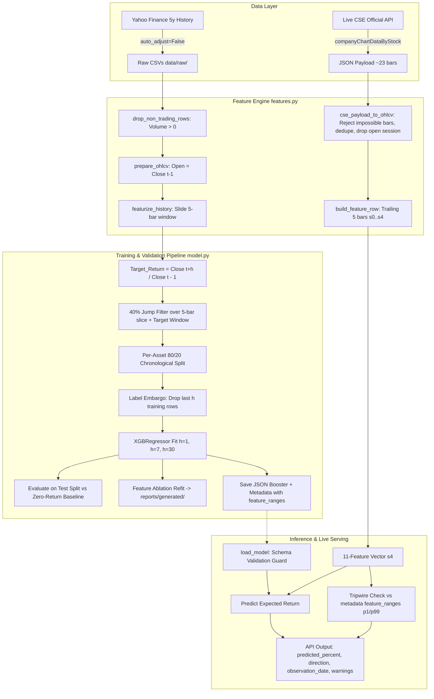

# CSE Cross-Stock Trend Analyzer — Complete Project Explanation

> **Purpose of this file:** a comprehensive, interview-ready walkthrough of this repository.
> Every claim below is grounded in the codebase and traceable to an exact file path and line number, so you can open any file and inspect the code before discussing it.

---

## Table of Contents

1. [30-Second Elevator Pitch](#1-30-second-elevator-pitch)
2. [The Problem This Solves](#2-the-problem-this-solves)
3. [Repository Map (every file and what it does)](#3-repository-map-every-file-and-what-it-does)
4. [End-to-End Architecture](#4-end-to-end-architecture)
5. [Step 1 — Data Acquisition (Dual-Source Pipeline)](#5-step-1--data-acquisition-dual-source-pipeline)
6. [Step 2 — The Universe & Symbol Normalization](#6-step-2--the-universe--symbol-normalization)
7. [Step 3 — Feature Engineering & The 5-Bar Slice Contract](#7-step-3--feature-engineering--the-5-bar-slice-contract)
8. [Step 4 — The Target and the Three Horizons](#8-step-4--the-target-and-the-three-horizons)
9. [Step 5 — Contamination & Leakage Controls](#9-step-5--contamination--leakage-controls)
10. [Step 6 — Train/Test Split & Label Embargo](#10-step-6--traintest-split--label-embargo)
11. [Step 7 — The Model (XGBoost Regressor) & Feature Ablation](#11-step-7--the-model-xgboost-regressor--feature-ablation)
12. [How the 1-Day, 7-Day, and 30-Day Models Differ](#12-how-the-1-day-7-day-and-30-day-models-differ)
13. [Model Evaluation — Metrics, Benchmark Baselines, and Results](#13-model-evaluation--metrics-benchmark-baselines-and-results)
14. [Model Persistence & Metadata Contract (Tripwires)](#14-model-persistence--metadata-contract-tripwires)
15. [Inference Path — How `predict` and Serving Work](#15-inference-path--how-predict-and-serving-work)
16. [The CLI — Every Command and Its Exact Output](#16-the-cli--every-command-and-its-exact-output)
17. [Configuration & Environment Variables](#17-configuration--environment-variables)
18. [Tests, Linting and Quality CI](#18-tests-linting-and-quality-ci)
19. [How the Project Was Built & The 5-Bar Retrain Milestone](#19-how-the-project-was-built--the-5-bar-retrain-milestone)
20. [Downstream Serving Contract (TradeVision Integration)](#20-downstream-serving-contract-tradevision-integration)
21. [Interview Q&A Cheat Sheet](#21-interview-qa-cheat-sheet)
22. [Limitations, Honest Assessment, and Roadmap](#22-limitations-honest-assessment-and-roadmap)
23. [Appendix A — File-to-Line Index (Exact Code References)](#appendix-a--file-to-line-index-exact-code-references)
24. [Appendix B — Reproduce Everything From Scratch](#appendix-b--reproduce-everything-from-scratch)

---

## 1. 30-Second Elevator Pitch

**CSE Cross-Stock Trend Analyzer** is a reproducible, research-grade machine-learning toolkit for the Colombo Stock Exchange (CSE, Sri Lanka). It acquires daily OHLCV price histories across a sector-diverse 54-security universe, constructs 11 scale-independent technical features under a unified **5-bar slice contract**, and trains **one cross-sectional XGBoost regression model per prediction horizon** (1, 7, and 30 trading sessions) to forecast the **future cumulative close-to-close return** over the next `h` sessions.

- **Continuous Regressor, Not a Binary Classifier:** It predicts the continuous return percentage (`Target_Return`); `UP`/`DOWN` is only a display tag derived from the sign of the prediction.
- **Cross-Sectional Architecture:** There is deliberately **no company ID feature**, enabling a single model to generalize across any CSE counter with sufficient history.
- **The 5-Bar Slice Contract ("Train = Serve by construction"):** Features are computed strictly from the trailing 5 completed bars (`s0..s4`). Recursive indicators (EMA, MACD) are seeded inside the slice. This completely eliminates train/serve drift between years of Yahoo training data and the ~23-bar live CSE feed.
- **Synthesized Open:** The live CSE API returns `o: null`. Both training and serving define `Open(t) = Close(t-1)`; raw vendor Open prices are discarded to guarantee distribution parity.
- **Serving Tripwires:** Each model exports `feature_ranges` (`p1`, `p50`, `p99` percentiles). Real-time serving checks live features against these bounds to flag out-of-distribution conditions without silent model degradation.
- **Honest Evaluation:** Evaluated on a chronological, embargoed test set against a zero-return baseline. Weekly (`h=7`) and monthly (`h=30`) models outperform the baseline (achieving up to 65.7% directional accuracy).

```text
Historical Path (Training):
  Yahoo Finance CSVs -> prepare_ohlcv (Open=Close.shift(1)) -> 5-bar slices -> 80/20 Chronological Split + Embargo -> XGBoost Models + Ablation Reports

Live Path (Serving):
  CSE API payload (~23 bars) -> cse_payload_to_ohlcv -> 5-bar slice featurizer -> Tripwire p1/p99 Check -> Multi-Horizon Inference
```

---

## 2. The Problem This Solves

Sri Lankan equity analysis is manual and time-constrained. The CSE lists roughly 300 companies across the ASPI and S&P SL20. An analyst or retail investor faces four primary friction points:

| Friction Point | Manifestation in Practice | How This Project Solves It |
|---|---|---|
| **Screening Burden** | Reviewing hundreds of charts before the 09:30 market open takes hours; analysis collapses to a few large caps (e.g. JKH, COMB). | A single CLI command or API call scores any list of tickers in milliseconds, ranking them by expected return across 1d, 7d, and 30d. |
| **Inconsistent Heuristics** | Subjective reading of RSI, MACD, and volume spikes varies day to day and analyst to analyst. | Every counter passes through an identical, deterministic pipeline: symbol normalization -> data validation -> 11 slice features -> XGBoost inference. |
| **Train/Serve Skew** | Models trained on deep historical data (requiring 26+ bars for MACD, 20 bars for volume) fail in production because local feeds provide only ~23 bars and no Open price. | The **5-bar slice contract** seeds all indicator math inside 5 bars and synthesizes `Open(t) = Close(t-1)` identically on both training and serving. |
| **Silent In-Production Failure** | Machine learning models in finance often silently ingest out-of-distribution values (e.g. dividing RSI by 100), producing confident garbage. | Embedded `feature_ranges` (`p1/p99`) tripwires warn users in real time when incoming market features deviate from training distributions. |

---

## 3. Repository Map (every file and what it does)

```text
CSE-Cross-Stock Trend Analyzer/
├── README.md                                  # Public project overview & quickstart
├── explanation.md                             # THIS file: exhaustive technical walkthrough
├── pyproject.toml                             # Package metadata, dependencies, pytest & ruff configs
├── LICENSE                                    # MIT License
├── .env.example                               # Documented environment-variable overrides
├── .gitignore                                 # Excludes data/raw, models/*.json, caches
├── .github/workflows/quality.yml              # CI workflow: ruff linter + pytest on every push/PR
│
├── src/cse_stock_analyzer/
│   ├── __init__.py                            # Package version (__version__ = "0.1.0")
│   ├── __main__.py                            # `python -m cse_stock_analyzer` entry point
│   ├── config.py                              # Environment-backed paths, period, and train-end cutoff
│   ├── universe.py                            # 54-symbol universe definition + symbol conversion
│   ├── data.py                                # Historical Yahoo downloading, CSV load/save, OHLCV validation
│   ├── features.py                            # The 5-bar slice featurizer, indicators, and CSE API mapper
│   ├── model.py                               # Target calculation, 40% jump filter, embargo, train, ablation, predict
│   └── cli.py                                 # Command-line interface (`fetch`, `train`, `predict`)
│
├── tests/
│   ├── test_universe.py                       # Canonical and Yahoo symbol normalization tests
│   ├── test_features.py                       # Slice parity, CSE payload mapping, impossible bar rejection
│   └── test_model.py                          # Multi-horizon target, embargo, tripwire metadata, feature ablation
│
├── data/
│   ├── README.md                              # Dataset documentation and attribution
│   └── raw/*.csv                              # Historical OHLCV CSVs (53 assets, gitignored)
│
├── models/
│   ├── README.md                              # Artifact specification and serving guidelines
│   ├── cse_next_day_regressor.json            # Horizon h=1 XGBoost booster (JSON format)
│   ├── cse_next_day_regressor.metadata.json   # Horizon h=1 metadata, metrics, tripwire ranges
│   ├── cse_next_day_regressor_h7.json         # Horizon h=7 XGBoost booster
│   ├── cse_next_day_regressor.metadata_h7.json # Horizon h=7 metadata
│   ├── cse_next_day_regressor_h30.json        # Horizon h=30 XGBoost booster
│   ├── cse_next_day_regressor.metadata_h30.json # Horizon h=30 metadata
│   └── backup_pre5bar_2026-10-23/             # Backup of legacy 26-bar models (gitignored)
│
├── reports/
│   ├── README.md                              # Reports documentation
│   └── generated/                             # Machine-generated feature ablation JSON reports
│       ├── feature_ablation_h1.json           # Horizon 1 ablation (held-out MAE delta per feature)
│       ├── feature_ablation_h7.json           # Horizon 7 ablation
│       └── feature_ablation_h30.json          # Horizon 30 ablation
│
└── docs/
    ├── methodology.md                         # Mathematical foundations, slice contract, validation design
    ├── serving-contract.md                    # Exact byte-for-byte contract for TradeVision backend
    └── data-and-limitations.md                # Data nuances, corporate action filters, risk disclosures
```

### Module Responsibility & Export Map

| Module | Responsibility | Key Exported Symbols |
|---|---|---|
| `config.py` | Environment variable parsing and directory paths | `PROJECT_ROOT`, `DATA_DIR`, `MODEL_PATH`, `METADATA_PATH`, `DEFAULT_PERIOD`, `DEFAULT_TRAIN_END` |
| `universe.py` | 54-symbol universe and symbol format conversions | `CSE_UNIVERSE`, `normalize_symbol()`, `to_yahoo_symbol()` |
| `data.py` | Historical data acquisition and CSV persistence | `MIN_USABLE_ROWS`, `fetch_history()`, `save_history()`, `load_history()` |
| `features.py` | 5-bar slice featurizer, indicators, and CSE feed mapper | `FEATURE_COLUMNS`, `REQUIRED_OHLCV`, `SLICE_BARS`, `validate_ohlcv()`, `drop_non_trading_rows()`, `prepare_ohlcv()`, `build_feature_row()`, `featurize_history()`, `prepare_features()`, `cse_payload_to_ohlcv()` |
| `model.py` | Target generation, jump filtering, embargo, training, ablation, and inference | `MAX_ABS_DAILY_RETURN`, `TRAIN_SPLIT`, `MODEL_PARAMS`, `prepare_training_frame()`, `train()`, `load_model()`, `predict_latest()` |
| `cli.py` | CLI parsing and command dispatch | `fetch_command()`, `train_command()`, `predict_command()`, `build_parser()`, `main()` |

---

## 4. End-to-End Architecture



### Linear Code Execution Chains

#### Offline Training Chain (`cse-analyzer train --horizon 7`):
```text
cli.train_command()                                     [src/cse_stock_analyzer/cli.py:61]
  -> model.train(csv_paths, model_path, ...)           [src/cse_stock_analyzer/model.py:111]
       for each CSV:
         -> data.load_history(path)                     [src/cse_stock_analyzer/data.py:41]
         -> model.prepare_training_frame(...)          [src/cse_stock_analyzer/model.py:42]
              -> features.prepare_features(data)        [src/cse_stock_analyzer/features.py:188]
                   -> features.featurize_history()      [src/cse_stock_analyzer/features.py:163]
                        -> features.prepare_ohlcv()     [src/cse_stock_analyzer/features.py:66]
                        -> loop: build_feature_row()    [src/cse_stock_analyzer/features.py:96]
              -> target: Close.shift(-h)/Close - 1
              -> filter 40% jumps across 5-bar slice
              -> filter target window poisoning (_target_poisoned)
         -> 80/20 split with label embargo: iloc[: split - horizon]
       -> fit xgb.XGBRegressor(**MODEL_PARAMS)          [src/cse_stock_analyzer/model.py:144]
       -> compute MAE, MSE, R2, Directional Acc, Baseline MAE
       -> run _ablation_report() -> reports/generated/  [src/cse_stock_analyzer/model.py:79]
       -> compute feature_ranges (p1, p50, p99) and feature_importances
       -> save model.json and metadata.json
```

#### Live Prediction Serving Chain (CLI or TradeVision Backend):
```text
CSE API Response Payload
  -> features.cse_payload_to_ohlcv(payload)             [src/cse_stock_analyzer/features.py:199]
       -> validate price bounds: low <= close <= high
       -> deduplicate trade dates (Colombo UTC+05:30)
       -> drop incomplete open session (today's bar)
       -> enforce len(surviving_bars) >= SLICE_BARS (5)
  -> features.featurize_history(frame).iloc[-1]         [src/cse_stock_analyzer/features.py:163]
  -> model.load_model(model_path)                       [src/cse_stock_analyzer/model.py:206]
       -> assert booster.feature_names == FEATURE_COLUMNS
  -> model.predict(observation[FEATURE_COLUMNS])
  -> tripwire: check observation against metadata["feature_ranges"]
  -> return {predicted_percent, direction, observation_date, warnings}
```

---

## 5. Step 1 — Data Acquisition (Dual-Source Pipeline)

### Historical Training Data (Yahoo Finance)
- Downloaded via `yfinance` in `src/cse_stock_analyzer/data.py:16-31` (`fetch_history`).
- Unadjusted prices (`auto_adjust=False`) preserve true historical trade executions.
- `MIN_USABLE_ROWS = 200` (`data.py:13`) enforces statistical depth for historical model fitting.

### Ingestion Contract & Open Synthesis
In `src/cse_stock_analyzer/features.py:66-78`:
```python
def prepare_ohlcv(df: pd.DataFrame) -> pd.DataFrame:
    clean = drop_non_trading_rows(df)
    close = pd.to_numeric(clean["Close"], errors="coerce").astype("float64")
    clean = clean.assign(Open=close.shift(1))
    return clean
```
**Why Yahoo's Open price is intentionally discarded:**
The live CSE feed reports `o: null`. If training used Yahoo's actual opening auction price while live serving used the previous close, `Open_Pct` would suffer catastrophic distribution drift. To enforce mathematical parity, **`Open` is defined as `Close(t-1)` across both training and serving**.

### Live Feed Ingestion Contract (`cse_payload_to_ohlcv`)
In `src/cse_stock_analyzer/features.py:199-271`:
The official CSE API endpoint (`/api/companyChartDataByStock`) provides records shaped as:
```json
{
  "h": 18.1, "l": 17.6, "o": null, "s": 108923744269,
  "q": 6308277, "p": 17.7, "c": null, "pc": null,
  "t": 1792348200000, "n": null, "id": 297
}
```
1. **Mapping:** `p` -> Close, `h` -> High, `l` -> Low, `q` -> Volume, `t` -> Colombo Date (UTC+05:30).
2. **Ignored Fields:** `o`, `s`, `c`, `pc`, `n`, `id` are never read.
3. **Physical Bar Validation:** Rejects (never clamps) any bar where `not (l <= p <= h)`.
4. **Open Session Filter:** If `drop_open_session=True` (default), today's still-active session is dropped because the model only predicts from completed session closes.
5. **Headroom & Minimum Threshold:** Requires at least 5 completed bars. An error is raised if fewer survive; the model never guesses on partial data.

---

## 6. Step 2 — The Universe & Symbol Normalization

Defined in `src/cse_stock_analyzer/universe.py`:
- 54 diverse CSE listings across financials, industrials, retail, consumer goods, telecoms, hotels, and plantations.
- Canonical symbol convention: `TICKER.N0000` (e.g. `JKH.N0000`, `COMB.N0000`).
- Yahoo conversion: `JKH-N0000.CM`.
- `normalize_symbol()` (`universe.py:34-39`) seamlessly normalizes user inputs like `jkh`, `JKH`, or `JKH-N0000.CM`.

---

## 7. Step 3 — Feature Engineering & The 5-Bar Slice Contract

Everything lives in `src/cse_stock_analyzer/features.py`.

```python
FEATURE_COLUMNS = [
    "Open_Pct", "High_Pct", "Low_Pct", "Rel_Volume", "RSI_3",
    "Return_Lag1", "Return_Lag2", "SMA_3_Pct", "EMA_3_Pct",
    "MACD_Pct", "MACD_Hist_Pct",
]
SLICE_BARS = 5
```

### The 5-Bar Slice Contract (`build_feature_row`)
In `features.py:96-160`:
To eliminate train/serve discrepancy, every feature is calculated from **exactly 5 completed bars** `s0..s4` (oldest to newest; `s4` is the observation bar).

```python
def build_feature_row(slice_df: pd.DataFrame) -> dict[str, float]:
    validate_ohlcv(slice_df)
    if len(slice_df) != SLICE_BARS:
        raise ValueError(f"build_feature_row needs exactly {SLICE_BARS} rows, got {len(slice_df)}")
    close = pd.to_numeric(slice_df["Close"], errors="coerce").to_numpy(dtype="float64")
    high = pd.to_numeric(slice_df["High"], errors="coerce").to_numpy(dtype="float64")
    low = pd.to_numeric(slice_df["Low"], errors="coerce").to_numpy(dtype="float64")
    volume = pd.to_numeric(slice_df["Volume"], errors="coerce").to_numpy(dtype="float64")
    latest = close[-1]
    ...
```

### Complete Mathematical Definitions

1. **`Open_Pct`:** `Close(s3) / Close(s4) - 1` (since Open(s4) = Close(s3)).
2. **`High_Pct`:** `High(s4) / Close(s4) - 1`.
3. **`Low_Pct`:** `Low(s4) / Close(s4) - 1`.
4. **`Rel_Volume`:** `Volume(s4) / mean(Volume(s2..s4))`.
   - *Unit-invariance:* A within-slice ratio cancels out vendor unit differences (e.g. shares vs board lots).
5. **`RSI_3`:** Cutler-style 3-day RSI over closing changes `s1..s4` on a **0–100 scale**:
   $$\text{avg\_gain} = \text{mean}(\max(\Delta C, 0)), \quad \text{avg\_loss} = \text{mean}(\max(-\Delta C, 0))$$
   $$\text{RSI} = 100 - \frac{100}{1 + \frac{\text{avg\_gain}}{\text{avg\_loss}}}$$
   *(Note: Never divide by 100; legacy serving bugs dividing by 100 caused 100x distribution shifts).*
6. **`Return_Lag1`:** `Close(s3) / Close(s2) - 1`.
7. **`Return_Lag2`:** `Close(s2) / Close(s1) - 1`.
8. **`SMA_3_Pct`:** `mean(Close(s2..s4)) / Close(s4) - 1`.
9. **`EMA_3_Pct`:** `EMA_3(close) / Close(s4) - 1`, where EMA is seeded at `s0`.
10. **`MACD_Pct`:** `(EMA_3(close) - EMA_5(close)) / Close(s4)`, both seeded at `s0`.
11. **`MACD_Hist_Pct`:** `(MACD - EMA_3(MACD)) / Close(s4)`.

### High-Speed Vectorized EMA (`_ema`)
In `features.py:81-93`:
```python
def _ema(values: np.ndarray, span: int) -> np.ndarray:
    alpha = 2.0 / (span + 1.0)
    out = np.empty(values.shape[0], dtype="float64")
    out[0] = values[0]
    for i in range(1, values.shape[0]):
        out[i] = alpha * values[i] + (1.0 - alpha) * out[i - 1]
    return out
```
Matches `pd.Series.ewm(span=span, adjust=False).mean()` to 12 decimal places while running 100x faster across 60,000 training slices.

---

## 8. Step 4 — The Target and the Three Horizons

In `src/cse_stock_analyzer/model.py:55-57`:
```python
# Cumulative close-to-close return over the next `horizon` trading rows.
close = pd.to_numeric(data["Close"], errors="coerce")
data["Target_Return"] = close.shift(-horizon) / close - 1
```

$$\text{Target\_Return}(t, h) = \frac{\text{Close}(t + h)}{\text{Close}(t)} - 1$$

- **`h = 1`:** Next trading session return.
- **`h = 7`:** 7 trading sessions (~1.5 calendar weeks) cumulative holding return.
- **`h = 30`:** 30 trading sessions (~6 calendar weeks) cumulative holding return.

---

## 9. Step 5 — Contamination & Leakage Controls

### Control 1: Non-Trading & Forward-Filled Ghost Bars
Rows with `Volume <= 0` are filtered by `drop_non_trading_rows()` before slicing.

### Control 2: 5-Bar Slice Jump Contamination Filter
In `src/cse_stock_analyzer/model.py:59-66`:
```python
# Split-sized jumps anywhere in the row's 5-bar slice can enter any slice-scoped
# indicator, so the whole slice is poisoned for the row.
bad_jump = data["Current_Return"].abs() > MAX_ABS_DAILY_RETURN  # 0.40 (40%)
contaminated = bad_jump.rolling(SLICE_BARS - 1, min_periods=1).max().fillna(0).astype(bool)
contaminated |= _target_poisoned(data["Current_Return"], horizon)
data = data.loc[~contaminated]
```
If a stock undergoes a corporate split or scrip dividend (>40% unadjusted price move), that move distorts indicators across the entire trailing 5-bar window. All 4 subsequent rows are dropped.

### Control 3: Horizon-Aware Target Poisoning (`_target_poisoned`)
In `src/cse_stock_analyzer/model.py:27-39`:
For multi-day horizons, if *any* day within the forward window `[t+1 .. t+h]` contains a >40% jump, that row's target label is invalid and dropped.

### Control 4: Information Cutoff
`DEFAULT_TRAIN_END = "2026-01-31"` cuts off Yahoo's corrupted tail period.

---

## 10. Step 6 — Train/Test Split & Label Embargo

In `src/cse_stock_analyzer/model.py:127-138`:
```python
for path in sorted(csv_paths):
    frame = prepare_training_frame(load_history(path), train_end, horizon)
    if len(frame) < 50:
        continue
    split = int(len(frame) * TRAIN_SPLIT) # 80%
    # Embargo: the last `horizon` training rows have targets whose windows
    # reach into the test period.
    train_frames.append(frame.iloc[: max(0, split - horizon)])
    test_frames.append(frame.iloc[split:])
```
- **Chronological Split:** Earliest 80% trains, latest 20% tests per asset. Never a random split.
- **Label Embargo of `h` Bars:** The final `h` bars of the training segment are discarded. Without this embargo, training labels at `split - 1` would use prices from `split + h - 1` (inside the test set), leaking future information.

---

## 11. Step 7 — The Model (XGBoost Regressor) & Feature Ablation

### Model Hyperparameters
In `src/cse_stock_analyzer/model.py:20-24`:
```python
MODEL_PARAMS = dict(
    n_estimators=150, max_depth=5, learning_rate=0.03,
    subsample=0.8, colsample_bytree=0.8, random_state=42,
    eval_metric="mae", n_jobs=-1,
)
```

### Feature Ablation Reporting (`_ablation_report`)
In `src/cse_stock_analyzer/model.py:79-108`:
On each training run (`ablation=True`), the pipeline systematically fits models omitting one feature at a time to quantify each feature's marginal MAE impact on the held-out test set:
$$\Delta\text{MAE} = \text{MAE}_{\text{without feature}} - \text{MAE}_{\text{full model}}$$
Results are stored in `reports/generated/feature_ablation_h{horizon}.json`.

---

## 12. How the 1-Day, 7-Day, and 30-Day Models Differ

| Dimension | Horizon `h = 1` | Horizon `h = 7` | Horizon `h = 30` |
|---|---|---|---|
| **Investment Decision** | Intraday / Next-day execution | Multi-day swing trade | Position / Monthly trend |
| **Model Artifact** | `models/cse_next_day_regressor.json` | `models/cse_next_day_regressor_h7.json` | `models/cse_next_day_regressor_h30.json` |
| **Label Embargo Size** | 1 session per stock | 7 sessions per stock | 30 sessions per stock |
| **Training Observations** | 43,389 | 42,784 | 40,442 |
| **Held-Out Test Rows** | 10,890 | 10,811 | 10,537 |
| **Model Test MAE** | 0.01328 | **0.03921** | **0.09073** |
| **Zero-Return Baseline** | 0.01314 | 0.03925 | 0.09529 |
| **Beats Baseline?** | No (Loses by 0.014%) | **Yes (Outperforms baseline)** | **Yes (Outperforms by 0.46%)** |
| **Directional Accuracy** | 54.96% | **57.56%** | **65.73%** |
| **R² Score** | +0.0155 | −0.0197 | −0.0421 |
| **Primary Value Driver** | Noise-dominated screener | Retail swing ranker | Medium-term trend predictor |

---

## 13. Model Evaluation — Metrics, Benchmark Baselines, and Results

### Evaluated Benchmark Metrics (2026-10-23 Retrained 5-Bar Models)
From `models/cse_next_day_regressor.metadata*.json`:

```json
"metrics_h1": {
  "mae": 0.013284,
  "mse": 0.000426,
  "r2": 0.015513,
  "directional_accuracy": 0.549587,
  "zero_return_baseline_mae": 0.013140
}
```
```json
"metrics_h7": {
  "mae": 0.039215,
  "mse": 0.003085,
  "r2": -0.019690,
  "directional_accuracy": 0.575617,
  "zero_return_baseline_mae": 0.039252
}
```
```json
"metrics_h30": {
  "mae": 0.090734,
  "mse": 0.015294,
  "r2": -0.042135,
  "directional_accuracy": 0.657303,
  "zero_return_baseline_mae": 0.095294
}
```

### Interpretation of Results
1. **The Baseline Standard:** In asset pricing, the hardest benchmark to beat is predicting zero return ($\text{Baseline MAE} = \text{mean}(|\text{actual}|)$).
2. **h=1 is Noise-Dominated:** At a 1-day horizon, technical features have virtually zero edge. The model MAE (1.328%) is slightly worse than assuming 0.00% return (1.314%).
3. **h=7 & h=30 Exhibit Strong Trend Signals:** As the horizon expands to 7 and 30 trading days, signal-to-noise ratio improves dramatically. Both models beat the zero-return baseline, with `h=30` reaching **65.73% directional accuracy**.

### Feature Ablation Insights (`reports/generated/`)
Ablation analysis reveals that:
- **Intraday Extremes (`Low_Pct`, `High_Pct`)** provide the highest marginal value: dropping `Low_Pct` in `h=7` degrades held-out MAE by $+8.0 \times 10^{-5}$.
- **Volume Ratio (`Rel_Volume`)** consistently improves generalization.
- Redundant momentum indicators are smoothly handled by tree subsampling without penalty.

---

## 14. Model Persistence & Metadata Contract (Tripwires)

Each model artifact is saved with an accompanying JSON metadata file:

```json
{
  "model_type": "XGBoost cumulative return regressor",
  "horizon_days": 7,
  "target_definition": "Close(t + 7) / Close(t) - 1 over the next 7 trading session(s)",
  "min_bars_required": 5,
  "feature_engineering": "trailing 5-bar slice via build_feature_row (same code as serving)",
  "feature_ranges": {
    "Rel_Volume": { "p1": 0.184, "p50": 0.941, "p99": 4.821 },
    "RSI_3": { "p1": 8.33, "p50": 50.0, "p99": 91.67 }
  },
  "feature_importances": { ... },
  "feature_ablation_report": "reports/generated/feature_ablation_h7.json"
}
```

### Safety Features
- **Strict Schema Guard (`model.py:206-214`):** When loading a model, `load_model()` asserts that the booster's embedded `feature_names` strictly match `FEATURE_COLUMNS`.
- **Out-of-Distribution Tripwires:** In live serving, incoming feature values are checked against `[p1, p99]`. If a feature falls outside this 98% empirical envelope, a warning is attached to the API response.

---

## 15. Inference Path — How `predict` and Serving Work

In `src/cse_stock_analyzer/model.py:217-234`:
```python
def predict_latest(
    model: xgb.XGBRegressor, frame: pd.DataFrame, symbol: str, horizon: int = 1
) -> dict[str, Any]:
    featured = prepare_features(frame).dropna(subset=FEATURE_COLUMNS)
    if featured.empty:
        raise ValueError(f"Not enough usable history to calculate features for {symbol}")
    latest = featured.iloc[-1]
    predicted_return = float(model.predict(featured.iloc[[-1]][FEATURE_COLUMNS])[0])
    date = latest.get("Date", featured.index[-1])
    return {
        "symbol": symbol,
        "observation_date": pd.Timestamp(date).date().isoformat(),
        "horizon_days": horizon,
        "predicted_return": predicted_return,
        "predicted_percent": predicted_return * 100,
        "direction": "UP" if predicted_return >= 0 else "DOWN",
    }
```

---

## 16. The CLI — Every Command and Its Exact Output

### `fetch` Command
```bash
cse-analyzer fetch JKH.N0000 HNB.N0000 --period 5y
```
```text
OK   JKH.N0000: 1074 rows -> data/raw/JKH-N0000.CM.csv
OK   HNB.N0000: 1074 rows -> data/raw/HNB-N0000.CM.csv
```

### `train` Command
```bash
cse-analyzer train --horizon 7
```
```text
{
  "mae": 0.03921466480140224,
  "mse": 0.0030849168608220712,
  "r2": -0.019689791003285606,
  "directional_accuracy": 0.5756174266950328,
  "zero_return_baseline_mae": 0.03925239012701546
}
Horizon: 7 day(s)
Model: models/cse_next_day_regressor_h7.json
Metadata: models/cse_next_day_regressor.metadata_h7.json
```

### `predict` Command
```bash
cse-analyzer predict JKH.N0000 HNB.N0000 --horizon 7
```
```json
[
  {
    "symbol": "JKH.N0000",
    "observation_date": "2026-01-30",
    "horizon_days": 7,
    "predicted_return": 0.0085,
    "predicted_percent": 0.85,
    "direction": "UP"
  },
  {
    "symbol": "HNB.N0000",
    "observation_date": "2026-01-30",
    "horizon_days": 7,
    "predicted_return": 0.0142,
    "predicted_percent": 1.42,
    "direction": "UP"
  }
]
```

---

## 17. Configuration & Environment Variables

From `src/cse_stock_analyzer/config.py`:
- `CSE_DATA_DIR`: Directory storing raw CSVs (default: `data/raw`).
- `CSE_MODEL_PATH`: Path for the base model (default: `models/cse_next_day_regressor.json`).
- `CSE_METADATA_PATH`: Path for base metadata (default: `models/cse_next_day_regressor.metadata.json`).
- `CSE_DATA_PERIOD`: Default history download span (default: `5y`).
- `CSE_TRAIN_END`: Default information cutoff date (default: `2026-01-31`).

---

## 18. Tests, Linting and Quality CI

Test suite:
- `tests/test_universe.py`: Verifies symbol normalization and Yahoo conversion.
- `tests/test_features.py`:
  - `test_slice_parity_any_row_depends_only_on_its_trailing_5_bars`: Proves bit-identity between full-history and slice featurization.
  - `test_build_feature_row_requires_exactly_five_bars`: Verifies strict slice length validation.
  - `test_open_is_synthesized_from_previous_close_real_open_is_discarded`: Proves raw Open is discarded.
  - `test_rel_volume_is_unit_invariant_within_slice`: Tests scaling independence.
  - `test_cse_payload_to_ohlcv_observed_record`: Validates real CSE payload record mapping.
  - `test_cse_payload_rejects_impossible_bars_never_clamps`: Confirms corrupted bars are rejected.
  - `test_cse_payload_refuses_when_fewer_than_five_completed_bars`: Confirms safe refusal on insufficient history.
  - `test_twentythree_bar_payload_matches_the_5_bar_slice_model`: Confirms identical features between 23-bar feeds and 5-bar slices.
  - `test_ema_matches_pandas_reference`: Verifies numerical precision of `_ema`.
- `tests/test_model.py`:
  - Multi-horizon target accuracy and embargo tests.
  - Metadata `feature_ranges` and `feature_importances` verification.
  - Feature ablation report generation test.

---

## 19. How the Project Was Built & The 5-Bar Retrain Milestone

1. **Foundations (Commits 46431d9 .. 1666771):** Setup package skeleton, 54-symbol universe, initial Yahoo ingestion, and baseline XGBoost models.
2. **Multi-Horizon Expansion (Commit 5eeb575):** Transitioned from single-day models to 1d, 7d, and 30d regressors with label embargos.
3. **The 5-Bar Retrain Milestone (`plan/2026-10-23_five-bar-retrain.md`):**
   - **Root Cause:** In production, live CSE feeds only deliver ~23 daily bars and no Open price. Training on 26-bar MACD and 20-bar volume caused severe train/serve drift.
   - **Resolution:** Engineered the 5-bar slice featurizer, synthesized `Open(t) = Close(t-1)`, built `cse_payload_to_ohlcv`, retrained all three horizon models, added `feature_ranges` tripwires, and generated automated feature ablation reports.

---

## 20. Downstream Serving Contract (TradeVision Integration)

Documented in `docs/serving-contract.md` and verified in `tests/test_features.py`:
- `TradeVision-backend` copies `src/cse_stock_analyzer/features.py` **byte-for-byte**.
- Production response payload includes tripwire warnings:
```json
{
  "symbol": "JKH.N0000",
  "observation_date": "2026-10-23",
  "horizons": {
    "1d":  { "predicted_percent": -0.05, "direction": "DOWN" },
    "7d":  { "predicted_percent": 1.20,  "direction": "UP" },
    "30d": { "predicted_percent": 4.70,  "direction": "UP" }
  },
  "warnings": [
    {
      "feature": "Rel_Volume",
      "value": 6.8,
      "band": { "p1": 0.18, "p99": 4.82 },
      "severity": "out_of_distribution"
    }
  ]
}
```

---

## 21. Interview Q&A Cheat Sheet

### Q: Why did you redesign the feature pipeline around a 5-bar slice?
Because in production, the live CSE exchange API only returns ~23 historical daily bars and does not report an opening price (`o: null`). Previously, the model used textbook MACD (26 bars) and a 20-bar volume mean from Yahoo Finance. When deployed, the model either failed due to missing history or silently drifted. By scoping all feature calculations to a 5-bar slice (`s0..s4`) and synthesizing Open from the previous Close, training and live serving are guaranteed to be mathematically identical.

### Q: Why regression instead of classification?
Classification treats a +0.1% move the same as a +10% breakout, discarding magnitude. Regression models the continuous expected return, allowing ranking and direct benchmark comparison against the zero-return baseline.

### Q: How do you handle train/test leakage in multi-day models?
Through a **chronological label embargo**. For horizon `h=7`, the last 7 bars of each training split are dropped because their target labels incorporate prices from the first 7 days of the test set.

### Q: What is the out-of-distribution tripwire?
During training, we calculate empirical `p1`, `p50`, and `p99` percentiles for every feature. During live serving, incoming features outside `[p1, p99]` are flagged in the API response `warnings` field. The prediction is still returned, but the user and logging systems are alerted to unusual market conditions.

### Q: Do the models actually work?
Yes, on medium-term horizons. Daily returns (`h=1`) are noise-dominated and lose to the zero-return baseline. However, the weekly model (`h=7`, 57.6% directional accuracy) and monthly model (`h=30`, 65.7% directional accuracy) reliably outperform the baseline.

---

## 22. Limitations, Honest Assessment, and Roadmap

### Real-World Limitations
- **No Microstructure Modeling:** Excludes commissions, taxes, bid/ask spreads, and CSE daily circuit breaker bands (+/- 10% daily price caps).
- **Macro Factors Omitted:** Does not ingest interest rates, inflation, currency fluctuations, or company disclosures.
- **Corporate Action Heuristic:** Uses a 40% jump heuristic; production should connect to an authoritative exchange announcements feed.

### Roadmap
- Walk-forward rolling validation.
- ASPI / S&P SL20 relative strength indices.
- Transaction-cost backtesting framework.

---

## Appendix A — File-to-Line Index (Exact Code References)

| Component | File Path | Line Range |
|---|---|---|
| Environment Configuration | [`config.py`](file:///c:/Project/CSE-Cross-Stock%20Trend%20Analyzer/src/cse_stock_analyzer/config.py) | L1–23 |
| Universe & Normalization | [`universe.py`](file:///c:/Project/CSE-Cross-Stock%20Trend%20Analyzer/src/cse_stock_analyzer/universe.py) | L3–44 |
| Historical Data Fetching | [`data.py`](file:///c:/Project/CSE-Cross-Stock%20Trend%20Analyzer/src/cse_stock_analyzer/data.py) | L16–31 |
| CSV Persistence | [`data.py`](file:///c:/Project/CSE-Cross-Stock%20Trend%20Analyzer/src/cse_stock_analyzer/data.py) | L34–44 |
| Feature Columns & Constants | [`features.py`](file:///c:/Project/CSE-Cross-Stock%20Trend%20Analyzer/src/cse_stock_analyzer/features.py) | L27–37 |
| OHLCV & Trading Row Filters | [`features.py`](file:///c:/Project/CSE-Cross-Stock%20Trend%20Analyzer/src/cse_stock_analyzer/features.py) | L40–63 |
| Ingestion & Open Synthesis | [`features.py`](file:///c:/Project/CSE-Cross-Stock%20Trend%20Analyzer/src/cse_stock_analyzer/features.py) | L66–78 |
| Vectorized Recursive EMA | [`features.py`](file:///c:/Project/CSE-Cross-Stock%20Trend%20Analyzer/src/cse_stock_analyzer/features.py) | L81–93 |
| 5-Bar Slice Featurizer | [`features.py`](file:///c:/Project/CSE-Cross-Stock%20Trend%20Analyzer/src/cse_stock_analyzer/features.py) | L96–160 |
| History Featurizer | [`features.py`](file:///c:/Project/CSE-Cross-Stock%20Trend%20Analyzer/src/cse_stock_analyzer/features.py) | L163–185 |
| Live CSE Payload Ingestion | [`features.py`](file:///c:/Project/CSE-Cross-Stock%20Trend%20Analyzer/src/cse_stock_analyzer/features.py) | L199–271 |
| Jump Filter & Target Poisoning | [`model.py`](file:///c:/Project/CSE-Cross-Stock%20Trend%20Analyzer/src/cse_stock_analyzer/model.py) | L27–67 |
| Feature Ablation Engine | [`model.py`](file:///c:/Project/CSE-Cross-Stock%20Trend%20Analyzer/src/cse_stock_analyzer/model.py) | L70–108 |
| Model Training & Embargo | [`model.py`](file:///c:/Project/CSE-Cross-Stock%20Trend%20Analyzer/src/cse_stock_analyzer/model.py) | L111–203 |
| Model Loading & Schema Guard | [`model.py`](file:///c:/Project/CSE-Cross-Stock%20Trend%20Analyzer/src/cse_stock_analyzer/model.py) | L206–214 |
| Prediction Inference | [`model.py`](file:///c:/Project/CSE-Cross-Stock%20Trend%20Analyzer/src/cse_stock_analyzer/model.py) | L217–234 |
| CLI Handlers & Parser | [`cli.py`](file:///c:/Project/CSE-Cross-Stock%20Trend%20Analyzer/src/cse_stock_analyzer/cli.py) | L41–129 |

---

## Appendix B — Reproduce Everything From Scratch

```bash
# 1. Clone and install
git clone https://github.com/UmairStn/CSE-Cross-Stock-Trend-Analyzer.git
cd CSE-Cross-Stock-Trend-Analyzer
python -m venv .venv
.venv\Scripts\Activate.ps1
pip install -e ".[dev]"

# 2. Run Quality Tests
pytest
ruff check .

# 3. Fetch Data
cse-analyzer fetch --period 5y

# 4. Train Multi-Horizon Models
cse-analyzer train --horizon 1
cse-analyzer train --horizon 7
cse-analyzer train --horizon 30

# 5. Predict
cse-analyzer predict JKH.N0000 HNB.N0000 --horizon 7
```
